<!-- Generated by scripts/build.mjs. Edit profile.config.json or the renderer. -->

<picture><source media="(max-width: 680px)" srcset="./dist/profile-mobile.bc6159d733.svg">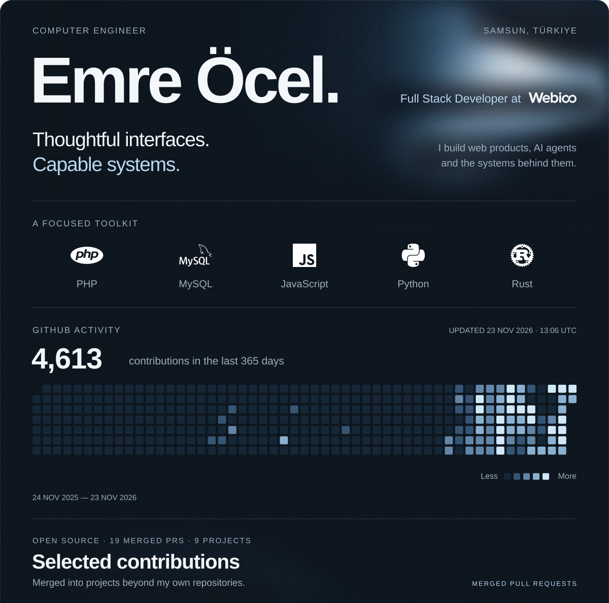</picture><picture><source media="(max-width: 680px)" srcset="./dist/panel/n8n-io-nod-info-mobile.c5a729b283.svg"></picture><a href="https://github.com/n8n-io/nod/pull/1223"><picture><source media="(max-width: 680px)" srcset="./dist/panel/n8n-io-nod-pr0-mobile.7258447e41.svg">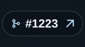</picture></a><a href="https://github.com/n8n-io/nod/pull/1227"><picture><source media="(max-width: 680px)" srcset="./dist/panel/n8n-io-nod-pr1-mobile.23fad99e50.svg">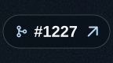</picture></a><a href="https://github.com/n8n-io/nod/pull/1228"><picture><source media="(max-width: 680px)" srcset="./dist/panel/n8n-io-nod-pr2-mobile.577b62fac8.svg">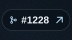</picture></a><a href="https://github.com/n8n-io/nod/pull/1232"><picture><source media="(max-width: 680px)" srcset="./dist/panel/n8n-io-nod-pr3-mobile.85bb4f2a82.svg">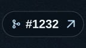</picture></a><a href="https://github.com/n8n-io/nod/pull/1233"><picture><source media="(max-width: 680px)" srcset="./dist/panel/n8n-io-nod-pr4-mobile.09e2ce72a7.svg">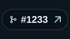</picture></a><a href="https://github.com/search?q=is%3Apr%20author%3Aemreocell%20is%3Amerged%20-user%3Aemreocell%20sort%3Aupdated-desc%20repo%3An8n-io%2Fnod&amp;type=pullrequests"><picture><source media="(max-width: 680px)" srcset="./dist/panel/n8n-io-nod-more-mobile.e3a696f701.svg"></picture></a><picture><source media="(max-width: 680px)" srcset="./dist/panel/awslabs-mcp-info-mobile.2ebaae7558.svg"></picture><a href="https://github.com/awslabs/mcp/pull/5123"><picture><source media="(max-width: 680px)" srcset="./dist/panel/awslabs-mcp-pr0-mobile.adaae89a92.svg">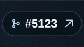</picture></a><a href="https://github.com/cdklabs/cdk-from-cfn/pull/1369"><picture><source media="(max-width: 680px)" srcset="./dist/panel/awslabs-mcp-pr1-mobile.36498cd8e1.svg">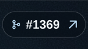</picture></a><a href="https://github.com/cdklabs/cdk-from-cfn/pull/1370"><picture><source media="(max-width: 680px)" srcset="./dist/panel/awslabs-mcp-pr2-mobile.1926bd55e1.svg"></picture></a><picture><source media="(max-width: 680px)" srcset="./dist/panel/stablyai-orca-info-mobile.be244e6fc4.svg"></picture><a href="https://github.com/stablyai/orca/pull/44637"><picture><source media="(max-width: 680px)" srcset="./dist/panel/stablyai-orca-pr0-mobile.8af1dcbaaa.svg">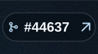</picture></a><a href="https://github.com/stablyai/orca/pull/44762"><picture><source media="(max-width: 680px)" srcset="./dist/panel/stablyai-orca-pr1-mobile.3c713eda8f.svg"></picture></a><picture><source media="(max-width: 680px)" srcset="./dist/panel/the-pr-agent-pr-agent-info-mobile.68fbd19515.svg"></picture><a href="https://github.com/The-PR-Agent/pr-agent/pull/5022"><picture><source media="(max-width: 680px)" srcset="./dist/panel/the-pr-agent-pr-agent-pr0-mobile.770ffcd92f.svg">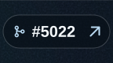</picture></a><a href="https://github.com/The-PR-Agent/pr-agent/pull/5023"><picture><source media="(max-width: 680px)" srcset="./dist/panel/the-pr-agent-pr-agent-pr1-mobile.6af774374f.svg"></picture></a><picture><source media="(max-width: 680px)" srcset="./dist/panel/ministackorg-ministack-info-mobile.be49fb62be.svg"></picture><a href="https://github.com/ministackorg/ministack/pull/2745"><picture><source media="(max-width: 680px)" srcset="./dist/panel/ministackorg-ministack-pr0-mobile.c4035c4bc8.svg">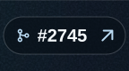</picture></a><a href="https://github.com/ministackorg/ministack/pull/2746"><picture><source media="(max-width: 680px)" srcset="./dist/panel/ministackorg-ministack-pr1-mobile.df9e25459e.svg"></picture></a><picture><source media="(max-width: 680px)" srcset="./dist/panel/libp2p-js-libp2p-info-mobile.54af9896e3.svg"></picture><a href="https://github.com/libp2p/js-libp2p/pull/3707"><picture><source media="(max-width: 680px)" srcset="./dist/panel/libp2p-js-libp2p-pr0-mobile.a54f9b12a3.svg"></picture></a><picture><source media="(max-width: 680px)" srcset="./dist/panel/repowise-dev-repowise-info-mobile.30c4fe5ab0.svg"></picture><a href="https://github.com/repowise-dev/repowise/pull/5887"><picture><source media="(max-width: 680px)" srcset="./dist/panel/repowise-dev-repowise-pr0-mobile.b4c0f7569c.svg"></picture></a><picture><source media="(max-width: 680px)" srcset="./dist/panel/tabularisdb-tabularis-info-mobile.83d53a0cc6.svg"></picture><a href="https://github.com/TabularisDB/tabularis/pull/1602"><picture><source media="(max-width: 680px)" srcset="./dist/panel/tabularisdb-tabularis-pr0-mobile.db286ce6c8.svg"></picture></a><picture><source media="(max-width: 680px)" srcset="./dist/panel/harnessrouter-harnessrouter-info-mobile.1632084182.svg"></picture><a href="https://github.com/HarnessRouter/harnessrouter/pull/718"><picture><source media="(max-width: 680px)" srcset="./dist/panel/harnessrouter-harnessrouter-pr0-mobile.6e85a7892e.svg"></picture></a><a href="https://github.com/search?q=author%3Aemreocell%20is%3Apr%20is%3Amerged%20-user%3Aemreocell&amp;type=pullrequests"><picture><source media="(max-width: 680px)" srcset="./dist/panel/browse-all-mobile.181e97b206.svg"></picture></a><picture><source media="(max-width: 680px)" srcset="./dist/panel/call-to-action-mobile.25e577f5a3.svg"></picture><a href="mailto:emreocell1219@gmail.com"><picture><source media="(max-width: 680px)" srcset="./dist/panel/contact-talk-mobile.2129fb2101.svg"></picture></a><a href="https://www.linkedin.com/in/emreocell/"><picture><source media="(max-width: 680px)" srcset="./dist/panel/contact-linkedin-mobile.52a065ceb4.svg"></picture></a><a href="https://webioo.com.tr/"><picture><source media="(max-width: 680px)" srcset="./dist/panel/contact-website-mobile.27019112ff.svg"></picture></a>

Profile in plain text

**Emre Öcel** · Computer Engineer · Samsun, Türkiye 
Full Stack Developer at [Webioo](https://webioo.com.tr/).

I build web products, AI agents and the systems behind them.

**A focused toolkit:** PHP · MySQL · JavaScript · Python · Rust.

**Selected open-source contributions:**

- [n8n Nod](https://github.com/n8n-io/nod) - [#1223](https://github.com/n8n-io/nod/pull/1223), [#1227](https://github.com/n8n-io/nod/pull/1227), [#1228](https://github.com/n8n-io/nod/pull/1228), [#1232](https://github.com/n8n-io/nod/pull/1232), [#1233](https://github.com/n8n-io/nod/pull/1233), [#1234](https://github.com/n8n-io/nod/pull/1234)
- [AWS](https://github.com/awslabs/mcp) - [awslabs/mcp](https://github.com/awslabs/mcp): [#5123](https://github.com/awslabs/mcp/pull/5123); [cdklabs/cdk-from-cfn](https://github.com/cdklabs/cdk-from-cfn): [#1369](https://github.com/cdklabs/cdk-from-cfn/pull/1369), [#1370](https://github.com/cdklabs/cdk-from-cfn/pull/1370)
- [Orca](https://github.com/stablyai/orca) - [#44637](https://github.com/stablyai/orca/pull/44637), [#44762](https://github.com/stablyai/orca/pull/44762)
- [PR-Agent](https://github.com/The-PR-Agent/pr-agent) - [#5022](https://github.com/The-PR-Agent/pr-agent/pull/5022), [#5023](https://github.com/The-PR-Agent/pr-agent/pull/5023)
- [Ministack](https://github.com/ministackorg/ministack) - [#2745](https://github.com/ministackorg/ministack/pull/2745), [#2746](https://github.com/ministackorg/ministack/pull/2746)
- [js-libp2p](https://github.com/libp2p/js-libp2p) - [#3707](https://github.com/libp2p/js-libp2p/pull/3707)
- [RepoWise](https://github.com/repowise-dev/repowise) - [#5887](https://github.com/repowise-dev/repowise/pull/5887)
- [Tabularis](https://github.com/TabularisDB/tabularis) - [#1602](https://github.com/TabularisDB/tabularis/pull/1602)
- [HarnessRouter](https://github.com/HarnessRouter/harnessrouter) - [#718](https://github.com/HarnessRouter/harnessrouter/pull/718)

**Contact:** [Let’s talk](mailto:emreocell1219@gmail.com) · [LinkedIn](https://www.linkedin.com/in/emreocell/) · [Webioo](https://webioo.com.tr/)

**GitHub activity:** 4,613 contributions from 2025-11-24 through 2026-11-23. 
Last successful refresh: 23 NOV 2026 · 13:06 UTC. Activity refreshes daily. 
[View activity on GitHub](https://github.com/emreocell?tab=overview)

