  

  

  

  

 

  <a href="mailto:emreocell1219@gmail.com">Email</a> &nbsp;·&nbsp;
  <a href="https://www.linkedin.com/in/emreocell/">LinkedIn</a> &nbsp;·&nbsp;
  <a href="https://emreocell.github.io/">Portfolio</a> &nbsp;·&nbsp;
  <a href="https://instagram.com/emre.ocel">Instagram</a>

