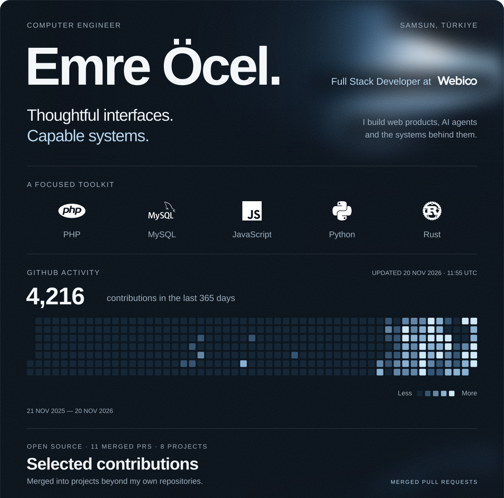
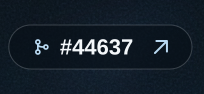
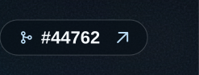
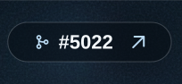
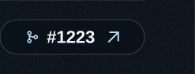

<!-- Generated by scripts/build.mjs. Edit profile.config.json or the renderer. -->

<picture><source media="(max-width: 680px)" srcset="./dist/profile-mobile.d36c480f90.svg"></picture><picture><source media="(max-width: 680px)" srcset="./dist/panel/stablyai-orca-info-mobile.1d4eb0a2b2.svg"></picture><a href="https://github.com/stablyai/orca/pull/44637"><picture><source media="(max-width: 680px)" srcset="./dist/panel/stablyai-orca-pr0-mobile.9d13a26790.svg"></picture></a><a href="https://github.com/stablyai/orca/pull/44762"><picture><source media="(max-width: 680px)" srcset="./dist/panel/stablyai-orca-pr1-mobile.1169db0753.svg"></picture></a><picture><source media="(max-width: 680px)" srcset="./dist/panel/the-pr-agent-pr-agent-info-mobile.d4ce3e1c8f.svg"></picture><a href="https://github.com/The-PR-Agent/pr-agent/pull/5022"><picture><source media="(max-width: 680px)" srcset="./dist/panel/the-pr-agent-pr-agent-pr0-mobile.5871ea1b82.svg"></picture></a><a href="https://github.com/The-PR-Agent/pr-agent/pull/5023"><picture><source media="(max-width: 680px)" srcset="./dist/panel/the-pr-agent-pr-agent-pr1-mobile.875ee34389.svg"></picture></a><picture><source media="(max-width: 680px)" srcset="./dist/panel/awslabs-mcp-info-mobile.630e8875e3.svg"></picture><a href="https://github.com/awslabs/mcp/pull/5123"><picture><source media="(max-width: 680px)" srcset="./dist/panel/awslabs-mcp-pr0-mobile.9c26f61172.svg"></picture></a><picture><source media="(max-width: 680px)" srcset="./dist/panel/repowise-dev-repowise-info-mobile.beb40e4158.svg"></picture><a href="https://github.com/repowise-dev/repowise/pull/5887"><picture><source media="(max-width: 680px)" srcset="./dist/panel/repowise-dev-repowise-pr0-mobile.b03ad1f9f1.svg"></picture></a><picture><source media="(max-width: 680px)" srcset="./dist/panel/tabularisdb-tabularis-info-mobile.2c5fb5c095.svg"></picture><a href="https://github.com/TabularisDB/tabularis/pull/1602"><picture><source media="(max-width: 680px)" srcset="./dist/panel/tabularisdb-tabularis-pr0-mobile.e890f6c84a.svg"></picture></a><picture><source media="(max-width: 680px)" srcset="./dist/panel/ministackorg-ministack-info-mobile.8993918e14.svg"></picture><a href="https://github.com/ministackorg/ministack/pull/2745"><picture><source media="(max-width: 680px)" srcset="./dist/panel/ministackorg-ministack-pr0-mobile.e2b7bf0a1d.svg"></picture></a><a href="https://github.com/ministackorg/ministack/pull/2746"><picture><source media="(max-width: 680px)" srcset="./dist/panel/ministackorg-ministack-pr1-mobile.635b10d9ab.svg"></picture></a><picture><source media="(max-width: 680px)" srcset="./dist/panel/harnessrouter-harnessrouter-info-mobile.fb83e0d3e6.svg"></picture><a href="https://github.com/HarnessRouter/harnessrouter/pull/718"><picture><source media="(max-width: 680px)" srcset="./dist/panel/harnessrouter-harnessrouter-pr0-mobile.3d08a6b6b6.svg"></picture></a><picture><source media="(max-width: 680px)" srcset="./dist/panel/n8n-io-nod-info-mobile.800b7498c1.svg"></picture><a href="https://github.com/n8n-io/nod/pull/1223"><picture><source media="(max-width: 680px)" srcset="./dist/panel/n8n-io-nod-pr0-mobile.e2627eacdc.svg"></picture></a><a href="https://github.com/search?q=author%3Aemreocell%20is%3Apr%20is%3Amerged%20-user%3Aemreocell&amp;type=pullrequests"><picture><source media="(max-width: 680px)" srcset="./dist/panel/browse-all-mobile.ef0894b9b3.svg"></picture></a><picture><source media="(max-width: 680px)" srcset="./dist/panel/call-to-action-mobile.d1f67407ef.svg"></picture><a href="mailto:emreocell1219@gmail.com"><picture><source media="(max-width: 680px)" srcset="./dist/panel/contact-talk-mobile.bf4db64370.svg"></picture></a><a href="https://www.linkedin.com/in/emreocell/"><picture><source media="(max-width: 680px)" srcset="./dist/panel/contact-linkedin-mobile.7fa3dc8b11.svg"></picture></a><a href="https://webioo.com.tr/"><picture><source media="(max-width: 680px)" srcset="./dist/panel/contact-website-mobile.5f2fc6be7c.svg"></picture></a>

Profile in plain text

**Emre Öcel** · Computer Engineer · Samsun, Türkiye 
Full Stack Developer at [Webioo](https://webioo.com.tr/).

I build web products, AI agents and the systems behind them.

**A focused toolkit:** PHP · MySQL · JavaScript · Python · Rust.

**Selected open-source contributions:**

- [Orca](https://github.com/stablyai/orca) — Model-catalog cache stability and WSL watcher diagnostics. [#44637](https://github.com/stablyai/orca/pull/44637), [#44762](https://github.com/stablyai/orca/pull/44762)
- [PR-Agent](https://github.com/The-PR-Agent/pr-agent) — Safer webhook automation and privacy-aware OpenAI logging. [#5022](https://github.com/The-PR-Agent/pr-agent/pull/5022), [#5023](https://github.com/The-PR-Agent/pr-agent/pull/5023)
- [AWS MCP Servers](https://github.com/awslabs/mcp) — Cleanup of LibreOffice process trees on timeouts and cancellation. [#5123](https://github.com/awslabs/mcp/pull/5123)
- [RepoWise](https://github.com/repowise-dev/repowise) — Hyperfine JSON benchmark support in evidence workflows. [#5887](https://github.com/repowise-dev/repowise/pull/5887)
- [Tabularis](https://github.com/TabularisDB/tabularis) — Clearer plugin sidebar: the deprecated built-in driver is marked. [#1602](https://github.com/TabularisDB/tabularis/pull/1602)
- [Ministack](https://github.com/ministackorg/ministack) — Cognito identity-provider validation to prevent invalid states. [#2745](https://github.com/ministackorg/ministack/pull/2745), [#2746](https://github.com/ministackorg/ministack/pull/2746)
- [HarnessRouter](https://github.com/HarnessRouter/harnessrouter) — Reliable self-hosted sign-in: usernames are trimmed. [#718](https://github.com/HarnessRouter/harnessrouter/pull/718)
- [n8n Nod](https://github.com/n8n-io/nod) — Welcome setup submits once when the engine restarts. [#1223](https://github.com/n8n-io/nod/pull/1223)

**Contact:** [Let’s talk](mailto:emreocell1219@gmail.com) · [LinkedIn](https://www.linkedin.com/in/emreocell/) · [Webioo](https://webioo.com.tr/)

**GitHub activity:** 4,216 contributions from 2025-11-21 through 2026-11-20. 
Last successful refresh: 20 NOV 2026 · 11:55 UTC. Activity refreshes daily. 
[View activity on GitHub](https://github.com/emreocell?tab=overview)

